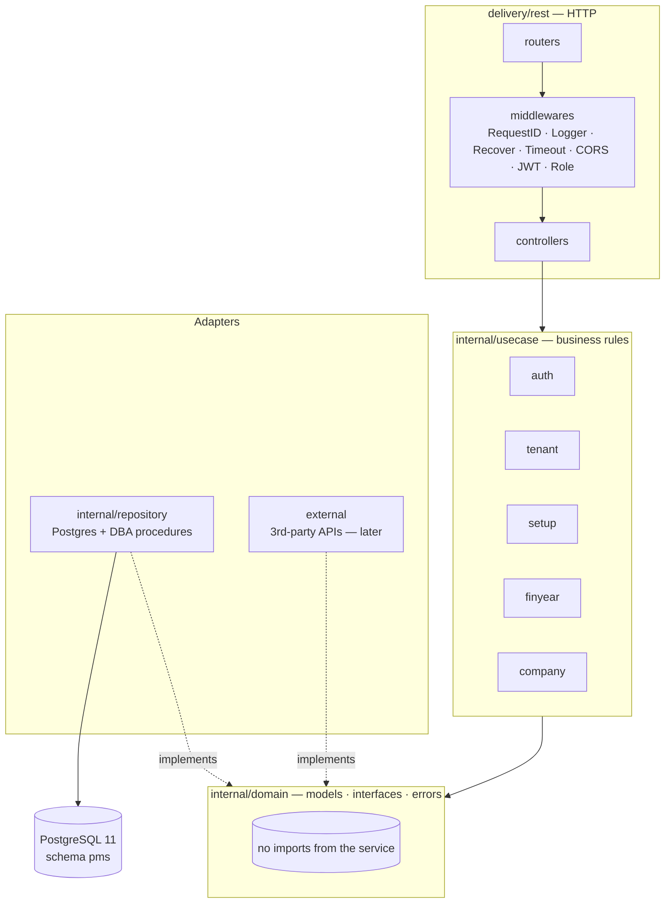
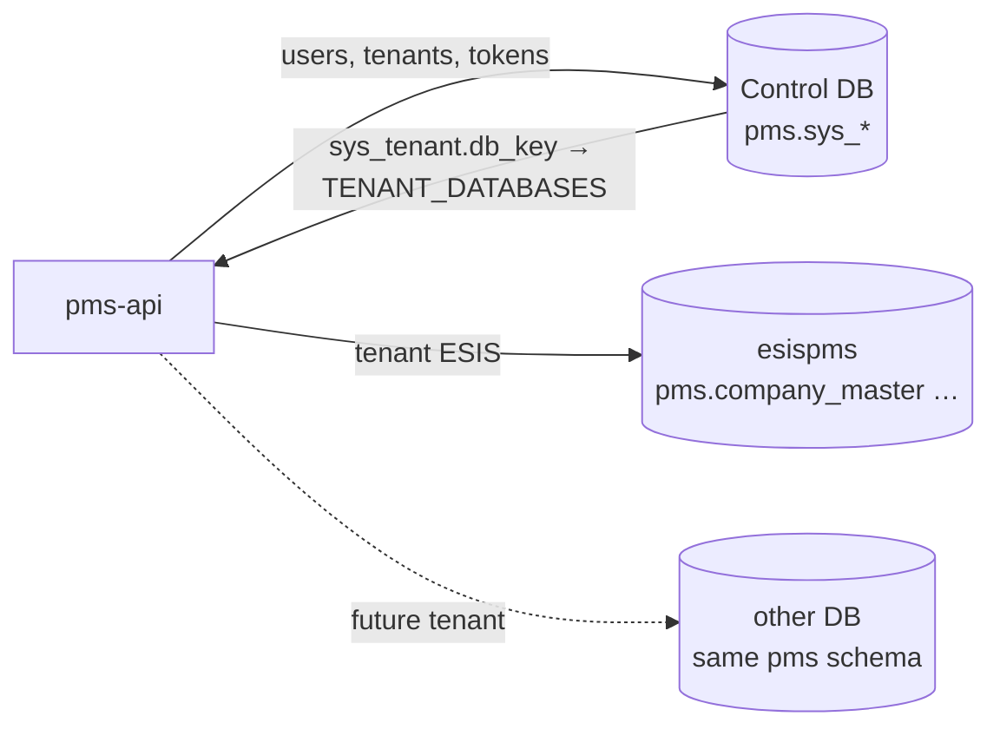

# Architecture

## 1. Layers

The service follows Clean Architecture, the same shape as our PFM service:
dependencies only point inwards, towards `domain`.



| Layer | Folder | Owns | Must not |
|---|---|---|---|
| Domain | `src/internal/domain/<module>` | Models, DTOs with `validate` tags, `Usecase` / `Repository` interfaces, `AppError`, `Principal` | Import anything else in the service |
| Use case | `src/internal/usecase/<module>` | Normalisation, rules, orchestration, which errors to return | Know about HTTP or SQL |
| Repository | `src/internal/repository/<module>` | SQL, transactions, calling the DBA's functions/procedures, mapping DB errors | Contain business rules |
| External | `src/external/<service>` | Clients for third-party APIs (email, SMS, WhatsApp…) | — (empty for now) |
| Delivery | `src/delivery/rest` | Routes, auth middleware, JSON in/out, status codes | Contain business rules |
| Packages | `src/packages/*` | Reusable, service-agnostic code: DB pools & migrations, validators, password hashing, logger | Import `internal/*` |

Every module repeats the same five pieces, so a new master (trust, vendor,
item…) is a copy of the company module:

```
domain/<m>/models.go        domain/<m>/interfaces.go
usecase/<m>/<m>.go          repository/<m>/postgres.go
delivery/rest/controllers/<m>/<m>.go   + routes in routers/routers.go
```

Registries wire them once: `repository/index.go` → `usecase/index.go` →
`delivery/rest/index.go`, all called from `main.go`.

## 2. Folder map

```
src/
├── main.go                              config → logger → DB pools → repos → usecases → HTTP
├── cmd/admin/main.go                    migrate · migrate-status · create-platform-admin
├── utils/config.go                      env config (caarlos0/env + .env)
├── packages/
│   ├── database/manager.go              control pool + one pool per tenant db_key
│   ├── database/migrate.go              goose, embedded migrations, table pms.sys_schema_migrations
│   ├── database/migrations/*.sql        our platform tables (pms.sys_*)
│   ├── validation/india.go              mobile · PIN · PAN · GSTIN(checksum) · email · website · states
│   ├── validation/gst.go                GST state codes · code → state · PAN inside GSTIN
│   ├── validation/validator.go          go-playground validator → field violations (all at once)
│   ├── security/security.go             argon2id hashing, timing-safe "no such user"
│   └── logger/logger.go                 slog (text locally, JSON in production)
├── internal/
│   ├── domain/
│   │   ├── errors.go                    AppError kinds → HTTP status in one place
│   │   ├── principal.go                 Role, Principal (the caller), context helpers
│   │   ├── auth/                        User, Claims (JWT), TokenPair, interfaces
│   │   ├── tenant/                      Tenant, inputs, interfaces
│   │   ├── setup/                       wizard Status and steps
│   │   ├── finyear/                     FinancialYear, input, options, year maths, DBA-message map
│   │   ├── company/                     Company (sl = 1), CompanyInput, limits, DBA-message map
│   │   └── taxdetails/                  TaxDetails (sl = 1, Form 3), input, write-only password
│   ├── usecase/
│   │   ├── index.go                     builds all use cases
│   │   ├── common/validate.go           DTO validation → domain.Validation
│   │   ├── auth/{auth,token}.go         login · refresh (rotating) · logout · authenticate · JWT issuer
│   │   ├── tenant/tenant.go             create tenant · list · create tenant admin
│   │   ├── setup/setup.go               next wizard step from year + company state
│   │   ├── finyear/finyear.go           options · rules · validate · create · list · current
│   │   ├── company/company.go           needs a year · normalise · check · validate · save · get
│   │   └── taxdetails/taxdetails.go     needs the company · normalise · check (all at once) · save · get
│   └── repository/
│       ├── index.go                     builds all repositories
│       ├── pgutil/                      Querier, tenant pool lookup, PG error helpers
│       ├── auth/postgres.go             sys_user · sys_refresh_token
│       ├── tenant/postgres.go           sys_tenant
│       ├── finyear/postgres.go          finyr_master + DBA function/procedure, locked txn
│       ├── company/postgres.go          company_master (sl = 1) + DBA function/procedure, locked txn
│       └── taxdetails/postgres.go       mst_company_tax_details (sl = 1) + DBA procedure, locked txn
├── external/doc.go                      placeholder for third-party clients
└── delivery/rest/
    ├── index.go                         router, middleware chain, http.Server
    ├── routers/routers.go               every route and its guards
    ├── middlewares/                     JWT auth · role/tenant guards · request id · request log
    ├── controllers/{auth,admin,setup,finyear,company,taxdetails,meta}/
    └── utils/                           JSON decode (strict), Respond, WriteError
```

## 3. Multi-tenancy

A **tenant** is one client organisation (e.g. ESIS). Inside a tenant the
business hierarchy is company → trusts → institutions.

**Model: one database per tenant**, with a central registry.



Why this model:

- The DBA's procedures are hard-coded to the `pms` schema and his tables have
  no tenant column. With a database per tenant they work **unchanged**.
- Strongest isolation: one tenant's data can never appear in another's query.
- `sys_tenant.db_key` is **unique**, and startup refuses two `TENANT_DATABASES` keys that point at
  the same host/port/database, so two tenants can never share a database.
- A tenant database that is down does not stop the API: it is logged at startup and that
  tenant's requests get `503` until it is back; the control database is required.
- Moving a tenant is a config change (`TENANT_DATABASES`), not a code change.

How a request finds its database: the access token's user → `GetPrincipal`
re-loads user + tenant (and checks both are active) → `Principal.DBKey` →
`database.Manager.Tenant(db_key)` → that pool. The tenant **never** comes from
the request body, URL or a header the caller controls.

Today the control tables and ESIS's business tables share `esispms` (we can
create tables in `pms` but not new schemas or databases).

## 4. Authentication and authorisation

| Token | Lifetime | Signed with | Carries | Stored? |
|---|---|---|---|---|
| Access | 15 min (`ACCESS_TOKEN_TTL`) | `JWT_ACCESS_SECRET` (HS256) | `sub`, `role`, `email`, `name`, `tid`, `tcode`, `typ=access` | No |
| Refresh | 30 days (`REFRESH_TOKEN_TTL`) | `JWT_REFRESH_SECRET` (HS256) | `sub`, `role`, `typ=refresh`, `jti` | `jti` in `pms.sys_refresh_token` |

- Different secrets **and** a `typ` claim: an access token can never be used to
  refresh and vice-versa. `alg` is pinned to HS256 (no `alg: none`).
- Every request re-loads the user from the database, so deactivating a user or
  suspending a tenant locks them out **immediately**, not when the token expires.
- Refresh **rotates**: each refresh token works once (`UPDATE … SET revoked_at
  … RETURNING`), logout revokes it, expired rows are cleaned at startup and hourly.
- **Reuse detection**: replaying a refresh token that was used more than 30 s ago
  (the grace lets two tabs refresh together) revokes every refresh token of that user.
- Tokens are checked with 30 s of clock leeway so API instances with slightly different clocks agree.
- Login answers the same for "wrong password" and "no such email", and spends
  the same argon2id time on both (OWASP parameters: 19 MiB, 2 passes). Login is rate-limited
  per client IP (`LOGIN_RATE_LIMIT_PER_MINUTE`, JSON `429`).
- The client IP is the TCP peer, unless it is a proxy listed in `TRUSTED_PROXIES`; only then is
  `X-Forwarded-For` read, right to left, skipping trusted hops. Headers like `True-Client-IP` or
  `X-Real-IP` are never trusted, so a client cannot pick its own rate-limit bucket or logged IP.

| Role | Can |
|---|---|
| `platform_admin` | Create/list tenants, create tenant admins. No tenant, so no company routes. |
| `tenant_admin` | Company setup for **their** tenant. No admin routes. |

There is no public sign-up. The first platform admin is created with the CLI.

## 5. Database objects

| Object | Owner | Purpose | How we use it |
|---|---|---|---|
| `pms.finyr_master` | DBA (`gensuperuser`) | Financial years (PK `finyr`, check end ≥ start) | Read with `SELECT`; written only through the procedure |
| `pms.finyr_master_validate(...)` | DBA | Returns `'SUCCESS'` or a message | Called on validate, and again inside the create transaction |
| `pms.mst_finyr_insert(...)` | DBA | Insert; `is_current = true` un-marks the others; RAISEs on duplicates | Called for create |
| `pms.mst_finyr_set_current(take_finyr)` | **Proposed** (written by us, Uncle agreed 9 Nov; he installs it) | Marks one existing year current and un-marks the rest; RAISEs if missing | Called by `PUT /financial-years/current`. Not on live until Uncle installs it |
| `pms.company_master` | DBA (`gensuperuser`) | Company details, one row `sl = 1` | Read with `SELECT`; written only through the procedure |
| `pms.company_master_validate(...)` | DBA | Returns `(is_valid, message)` | Called on validate, and again inside the save transaction |
| `pms.company_master_insert(...)` | DBA | Upsert by `sl` | Called for every save with `sl = 1`. It does **not** validate, so we always validate first |
| `pms.mst_company_tax_details` | DBA (v1.01) | Company tax and contact details (Form 3), one row `sl = 1`, FK to `company_master` | Read with `SELECT` (never the password column's value, only whether it is set); written only through the procedure |
| `pms.mst_company_tax_details_insert(...)` | DBA (v1.01) | Upsert by `sl`, 12 arguments, replaces every column | Called for every save with `sl = 1`. No validate function exists: every rule is ours |
| `pms.mst_trust`, `pms.mst_trust_validate(...)`, `pms.mst_trust_insert(...)` | DBA (v1.01) | Trusts (Form 4) | Not used yet (PR 2). Only the table is in the local SQL; the function is broken on live and the procedure is not installed |
| `pms.sw_config`, `pms.config_sw_insert(...)` | DBA | App settings | Not used yet |
| `pms.sys_tenant` / `sys_user` / `sys_refresh_token` | Us (migration 00001) | Platform | Tenants, logins, refresh tokens |
| `pms.sys_schema_migrations` | Us (goose) | Migration bookkeeping | — |

`db/legacy/001_pms_objects.sql` is a verbatim copy of the DBA's SQL (the
PROCUREMENT.ESIS bundle) so local Postgres and the end-to-end test run against
the exact same functions and procedures. The bundle has no `CREATE TABLE` for
`finyr_master` / `company_master`; those two are rebuilt from the live catalog.

The v1.01 tables (`mst_company_tax_details`, `mst_trust`) and
`mst_company_tax_details_insert` are copied from `tables_VER_01_1.txt` and the
procedure file in the v1.01 bundle.

`mst_finyr_set_current` at the end of the file is **proposed**, not Uncle's yet:
replace it with his installed text before the set-current PR leaves draft.

## 6. Setup wizard

The walkthrough's wizard, in order. `GET /setup/status` returns `next_step`.

1. **Financial year** (`pms.finyr_master`)
2. **Company** (`pms.company_master`, one row `sl = 1`) — refused until a current financial year exists

### Financial year rules

Checked before the DBA's function, which on its own lets through `abc`,
`2026-20270` (then the insert fails on the 9-character column), year labels
that don't match the dates, and 18-month ranges.

| Rule | Source |
|---|---|
| `finyr` is `YYYY-YYYY` with consecutive years | walkthrough ("9 characters, start year – end year") |
| The previous year, the current one, or up to `FY_FUTURE_YEARS` (default 1, 0–5) after it, by today in `DEFAULT_TIMEZONE` | walkthrough v1.01 (in 2026-2027, 2027-2028 may be created) |
| Dates are 1 April → 31 March; sent dates must match | walkthrough ("1st April to 31st March of next year") |
| Which year is current: while none is, the new one; else an explicit `finyr_is_current`; else today's year | decided inside the locked transaction, so creating the previous year first cannot leave it current (no procedure changes it later). A future year is current only when asked |
| Not a duplicate, no overlap | DBA function (re-run in a locked transaction) |
| Change the current year later | `PUT /financial-years/current`: under the same advisory lock as create, check the year exists, then `CALL pms.mst_finyr_set_current`; already current is a no-op |

## 7. Company rules

Applied in this order; **all** field problems are returned together.

1. **Normalise** — trim everything; mobile `+91 98765-43210` → `9876543210`;
   email lower-cased; website trailing `/` removed; country defaults to
   `India`; Indian state matched case-insensitively to its official spelling.
2. **Our checks** (column limits included, so nothing is ever too long for the table):

   | Field | Rule |
   |---|---|
   | `name` | required, ≤ 300 |
   | `shortname` | required, ≤ 50 |
   | `fin_st_dt` | `YYYY-MM-DD`, must be **1 April**, and if sent the `finyr_st_date` of an existing financial year; defaults to the current financial year's start |
   | `pin` | optional, 6 digits, not starting with 0 |
   | `mobile` | optional, 10 digits starting 6–9 (after normalising) |
   | `email` | optional, ≤ 200, same pattern as the DBA's check |
   | `website` | optional, ≤ 150, domain with optional http(s) |
   | `state` | ≤ 200; if country is India, one of the 36 states/UTs |
   | `address` / `city` / `country` / `header_1` / `header_2` | ≤ 300 / 200 / 200 / 200 / 200 |

3. **DBA's check** — `pms.company_master_validate`; its message is mapped to
   the field it concerns.
4. **Save** — one transaction holding an advisory lock: look up `sl = 1`
   (exists → update, keep `time_zone`; missing → create), re-run the DBA's
   check, `CALL pms.company_master_insert(1, …)`.

There is exactly one company (DBA: "by default it would have only one record
with sl=1, any alteration would update to same record"). The backend owns `sl`
(never accepted from the client; unknown body fields are rejected) and
`time_zone` (stamped on first save in `DEFAULT_TIMEZONE`, kept afterwards).

## 8. Company tax and contact details (Form 3)

One record, `sl = 1`, saved through `pms.mst_company_tax_details_insert`.
The company must exist first (`409 Save the company details first`). No field
is mandatory; anything entered must be valid, and every problem is returned in
one 422.

| Field | Rule |
|---|---|
| `pan` | trim, upper-case; `IsPAN` |
| `pan_enabled`, `pan_enabled_dt` | The number stays optional when enabled (Uncle: "optional, but if they key PAN or GSTIN we should validate it"). The date is only allowed when enabled, cannot be after today, and defaults to today |
| `gstin` | trim, upper-case; `IsGSTIN` (format + check digit); first 2 digits a code from `GSTStates`; if `pan` is filled, characters 3–12 must equal it |
| `gstin_enabled`, `gstin_enabled_dt` | as for PAN, against `gstin` |
| `gstin_state` | ≤ 100, official spelling from `GSTStates`. With a GSTIN: empty → filled from its code; filled → must match its code |
| `comm_mail_id` | trim, lower-case, ≤ 150, `IsEmail` |
| `comm_mail_pwd` | write-only, ≤ 150, not trimmed. Missing or `null` keeps the stored one; `""` clears it; text replaces it. Never returned or logged; responses carry `comm_mail_pwd_set` |
| `comm_mobile`, `comm_whatsapp` | `NormalizeIndianMobile`, then `IsIndianMobile` |

**Save** — one transaction holding `pg_advisory_xact_lock(hashtext('pms.mst_company_tax_details'))`:
check `company_master` has `sl = 1`, read the stored password (`FOR UPDATE`) so a
missing one is kept (the procedure replaces every column), then
`CALL pms.mst_company_tax_details_insert(1, …)`. `201` when the row was created, `200` after.

## 9. Errors

Use cases return `domain.AppError`; `delivery/rest/utils.WriteError` is the
only place that maps them to HTTP.

| Kind | HTTP | When |
|---|---|---|
| `invalid_params` | 400 | Malformed JSON, wrong content type, bad query |
| `unauthorized` | 401 | No/invalid/expired token, wrong credentials |
| `forbidden` | 403 | Wrong role, platform admin on tenant routes, disabled account at login (mid-session it is 401) |
| `not_found` | 404 | Unknown record or route |
| `method_not_allowed` | 405 | Route exists but not for this HTTP method |
| `rate_limited` | 429 | Too many login attempts from one IP |
| `conflict` | 409 | Duplicate financial year / overlap / tenant code / email / db_key; company before financial year; tax details before company |
| `validation_failed` | 422 | Field rules failed (with `fields[]`) |
| `internal_error` | 500 | Anything unexpected; logged with cause, caller sees a generic message |
| `service_unavailable` | 503 | A database could not be reached, or Postgres is shutting down or starting up |
| `timeout` | 504 | The request ran past `REQUEST_TIMEOUT` (e.g. a stuck database) |

## 10. Open items for the DBA

1. Agree to the `pms.sys_*` tables (or provide a separate `platform` schema).
2. `company_master.time_zone` is `TIMESTAMPTZ`, so the zone name is lost;
   `VARCHAR` holding `Asia/Kolkata` would keep it.
3. A `rec_updated_at` column on `company_master`.
4. Install the proposed `pms.mst_finyr_set_current(take_finyr)` (in `db/legacy`, agreed 9 Nov). There is still no way to edit or delete a year.
5. `finyr_master_validate` does not check the `YYYY-YYYY` format, the 1 April–31 March
   dates or the 9-character limit — we enforce them in the API.
6. Confirm the 1 April rule for `fin_st_dt` and which company fields are mandatory.
7. `mst_trust_validate` reads `pms.mst_fin_year`, which does not exist (`finyr_master`); `mst_trust_insert` is not installed on live (blocks trusts).
8. How many future financial years may be created (built: `FY_FUTURE_YEARS`, default 1).
9. `comm_mail_pwd` is the password for sending and receiving mail (Uncle, 9 Nov). Built write-only, never returned or logged; it is stored as plain text, so encrypt it in the app before mail sending is built.
10. PAN/GSTIN numbers are optional even when enabled, validated when keyed (Uncle, 9 Nov). Still open: is the enabled date the registration date, and may it be in the future? (built: not after today).
