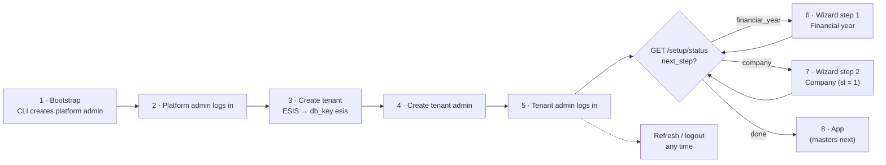
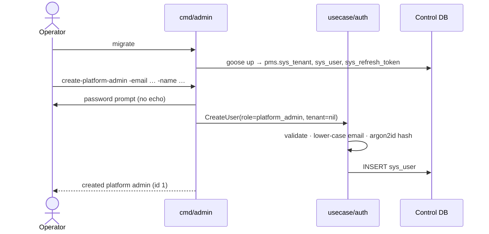
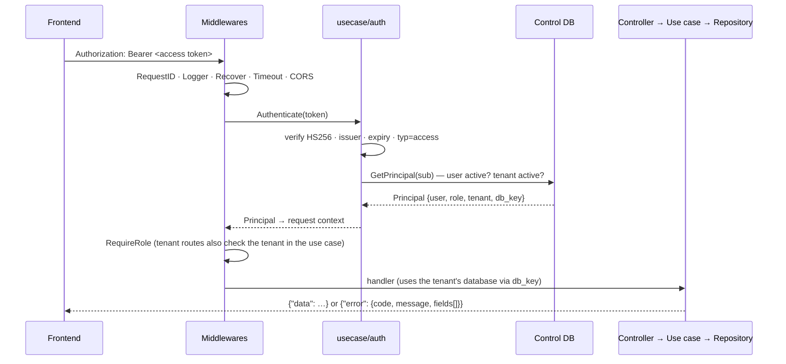
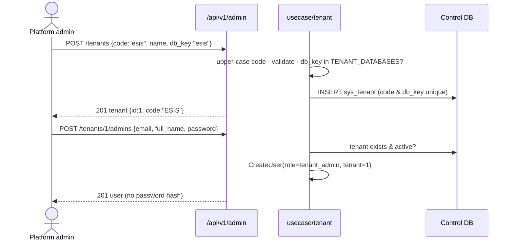
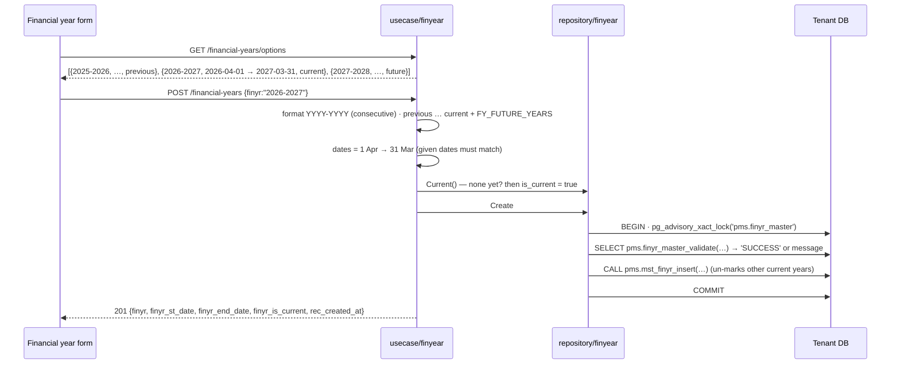
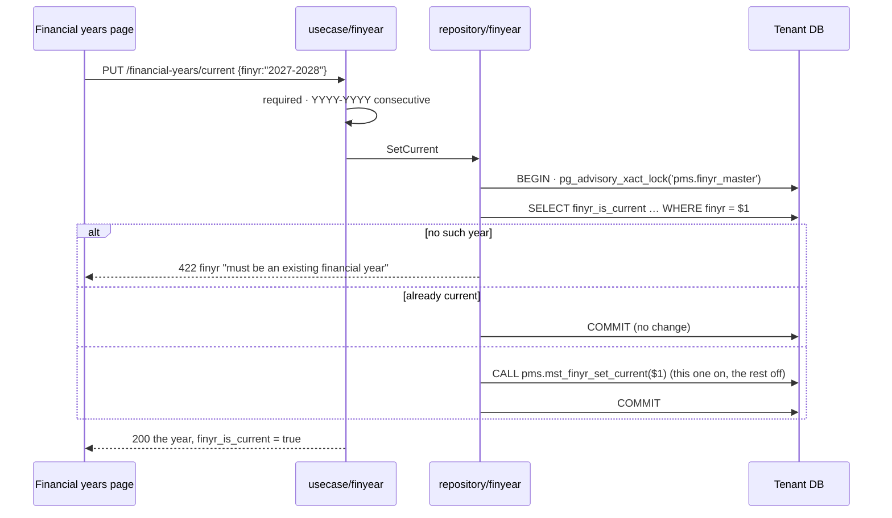
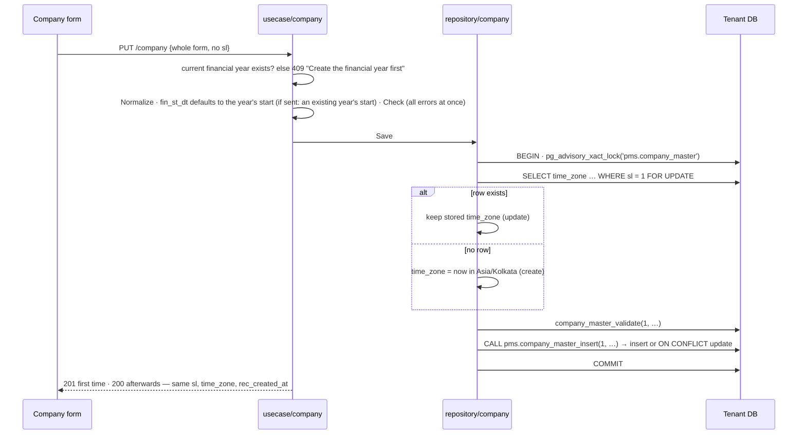
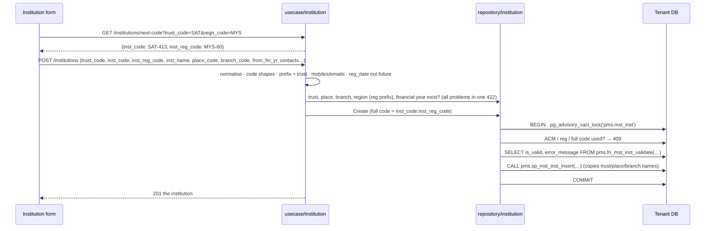

# End-to-end flows

Every flow below is exercised by `src/delivery/rest/e2e_test.go` against a real
PostgreSQL 11 loaded with the DBA's SQL (`db/legacy`).

## 0. The big picture



## 1. Bootstrap (one time, from a terminal)



There is no sign-up endpoint; every other account is created by an admin.

## 2. Request lifecycle (every protected call)



## 3. Login, refresh, logout

```mermaid
sequenceDiagram
    participant FE as Frontend
    participant API as /api/v1/auth
    participant UC as usecase/auth
    participant DB as Control DB
    FE->>API: POST /login {email, password}
    UC->>DB: user by email
    UC->>UC: argon2id compare (same cost if user missing)
    UC->>DB: GetPrincipal (active user + active tenant)
    UC->>UC: sign access (15m) + refresh (30d, new jti)
    UC->>DB: INSERT sys_refresh_token(jti)
    API-->>FE: {access_token, refresh_token, expires_in, user}
    Note over FE: keep tokens; send access token as Bearer
    FE->>API: POST /refresh {refresh_token}  (when access expires)
    UC->>UC: verify refresh token (other secret, typ=refresh)
    UC->>DB: UPDATE … SET revoked_at=now() WHERE jti=… AND not revoked RETURNING user_id
    UC-->>FE: new pair (old refresh token is now dead)
    FE->>API: POST /logout {refresh_token}
    UC->>DB: revoke jti
    API-->>FE: 204
```

## 4. Tenant onboarding (platform admin)



## 5. Setup wizard — status

`GET /api/v1/setup/status` tells the frontend which screen to show:

| State | Response |
|---|---|
| Nothing set up | `{financial_year_done:false, company_done:false, next_step:"financial_year"}` |
| Year done | `{financial_year_done:true, current_financial_year:"2026-2027", company_done:false, next_step:"company"}` |
| Both done | `{…, company_done:true, next_step:"done"}` |

## 6. Wizard step 1 — financial year



"Today" is taken in `DEFAULT_TIMEZONE` (Asia/Kolkata). On 02-11-2026 the choices
are 2025-2026 and 2026-2027 (the default `FY_FUTURE_YEARS=0`; with 1, also 2027-2028).
Years can be created at any time, not only during setup; a future year, when
allowed, is not current unless `finyr_is_current: true` is sent.

DBA messages are mapped to fields: *already exists* and *overlap* → `409` on
`finyr`; missing dates / end before start → `422` on the date fields.

### Make another year current



## 7. Wizard step 2 — company (single record, sl = 1)



`POST /company/validate` runs the same checks without saving. `GET /company`
returns the record (404 before the first save). `PUT` replaces every editable
field: send the full form; empty optional fields become `NULL`.

## 8. Company tax and contact details (Form 3, single record sl = 1)

```mermaid
sequenceDiagram
    participant FE as Tax details form
    participant UC as usecase/taxdetails
    participant R as repository/taxdetails
    participant T as Tenant DB
    FE->>UC: PUT /company/tax-details {whole form, comm_mail_pwd only if typed}
    UC->>UC: Normalize (upper-case PAN/GSTIN, lower-case email, 10-digit mobiles)
    UC->>UC: Check: PAN · GSTIN check digit + state code + PAN inside · state · email · mobiles · dates (all at once)
    UC->>UC: enabled without a date → today · empty gstin_state → from GSTIN code
    UC->>R: Save(record, keep / replace / clear password)
    R->>T: BEGIN · pg_advisory_xact_lock('pms.mst_company_tax_details')
    R->>T: company_master has sl = 1? else 409 "Save the company details first"
    R->>T: SELECT comm_mail_pwd … WHERE sl = 1 FOR UPDATE
    alt row exists
        R->>R: update; password not sent → reuse the stored one
    else no row
        R->>R: create
    end
    R->>T: CALL pms.mst_company_tax_details_insert(1, …)  → insert or ON CONFLICT update
    R->>T: COMMIT
    UC-->>FE: 201 first time · 200 afterwards — comm_mail_pwd_set, never the password
```

There is no DBA validate function for tax details: every rule is in Go (and
mirrored in React for instant feedback). `POST /company/tax-details/validate`
runs the same checks without saving.

## 9. Trusts (Form 4)

```mermaid
sequenceDiagram
    participant FE as Trusts page
    participant UC as usecase/trust
    participant R as repository/trust
    participant T as Tenant DB
    FE->>UC: POST /trusts {trust_code, trust_desc, wrk_st_finyr, wrk_st_date}
    UC->>UC: trim · code upper-case, ^[A-Z]{3}$ · desc ≤ 100 · date format
    UC->>R: finyr_master has wrk_st_finyr? date inside 1 Apr → 31 Mar? (else 422)
    UC->>R: Create
    R->>T: BEGIN · pg_advisory_xact_lock('pms.mst_trust')
    R->>T: code already used? → 409 trust_code
    R->>T: description used by another trust (ignoring case)? → 409 trust_desc
    R->>T: SELECT is_valid, take_error_msg FROM pms.mst_trust_validate(…)
    R->>R: each sentence → its field (422, or 409 for a duplicate description)
    R->>T: CALL pms.mst_trust_insert(…)  (upsert; sets last_update_at)
    R->>T: COMMIT
    UC-->>FE: 201 the trust
```

`PUT /trusts/{code}` is the same with "the code must exist" (404) in place of
"the code must be free", and the body has no `trust_code`. `POST /trusts/validate`
runs every check without writing. `GET /trusts` is `[]` before the first trust.

## 10. Places, branches, regions and institutions (Form 5)



Places, branches and regions follow the same steps with `code` and `name` only, the
DBA's `mst_*_validate` and `mst_*_insert`, and a lock per table.

## 11. What the frontend needs to know

| Need | How |
|---|---|
| Who is logged in | Decode the access token (`role`, `name`, `email`, `tid`, `tcode`) or `GET /auth/me` |
| Which screen | `platform_admin` → tenant admin screens. `tenant_admin` → `GET /setup/status` → `next_step` |
| Year dropdown | `GET /financial-years/options` (`exists:true` → already created) |
| Company form prefill | `GET /company` (404 = empty form) |
| State dropdown | `GET /meta/indian-states` |
| GST state dropdown | `GET /meta/gst-states` (`code` + `name`) |
| Tax details form | `GET /company/tax-details` (404 = empty form); `comm_mail_pwd_set` drives a "password saved — change?" field; send `comm_mail_pwd` only when typed |
| Trusts page | `GET /trusts` (list), `POST /trusts` (add), `PUT /trusts/{code}` (edit; code read-only), `DELETE /trusts/{code}` (409 with the DBA's reason while in use), `GET /financial-years` for the year dropdown; 409s carry `fields` for `trust_code` / `trust_desc` |
| Places / branches / regions | `GET /places` (list), `POST /places` (add), `DELETE /places/{code}` (204, or 409 with the DBA's reason while an institution uses it); same for `/branches`, `/regions`; no edit yet |
| Institutions | `GET /institutions?trust_code=&branch_code=&place_code=&q=&page=` (paged), `GET /institutions/next-code` to pre-fill codes, `POST /institutions` (add), `GET /institutions/{code}` (details); no edit yet; Excel import: `GET /institutions/import/template`, then `POST /institutions/import?dry_run=true` to preview and `POST /institutions/import` to save the ready rows |
| Token expired | Any `401` → `POST /auth/refresh` once and retry; if that 401s, go to login |
| Field errors | `error.fields[]` → show `message` under the input named `field` |
| Support | Every response has `X-Request-Id`; errors include `request_id` |
